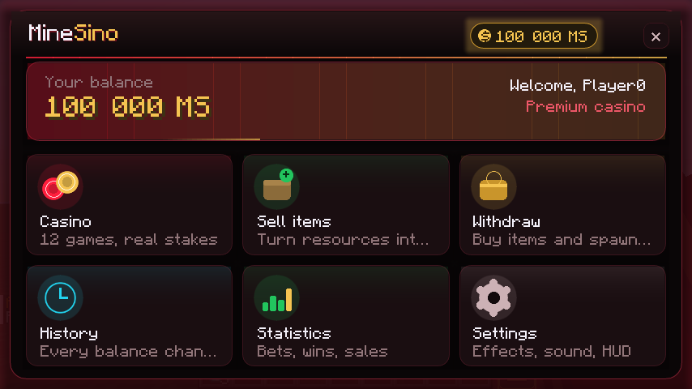
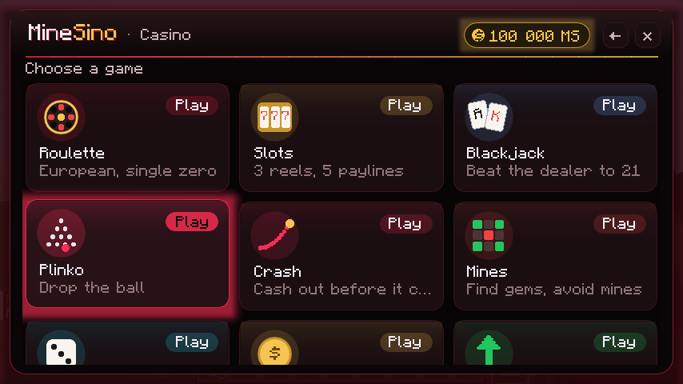
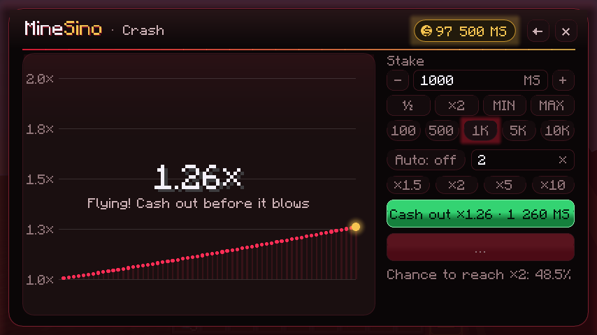
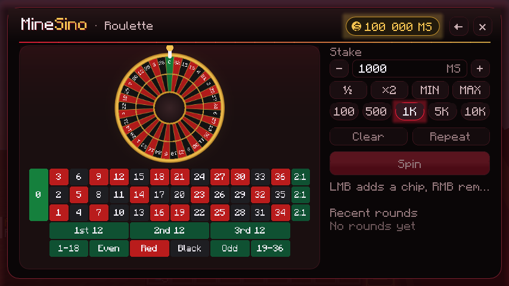
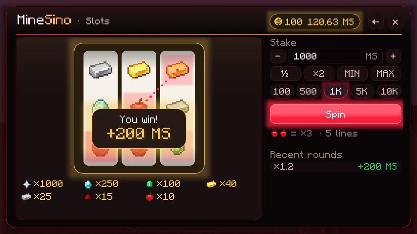
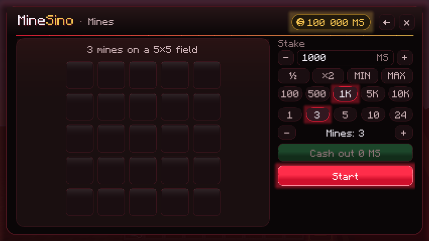
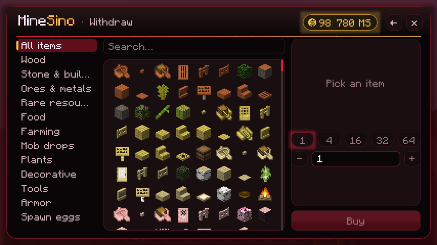
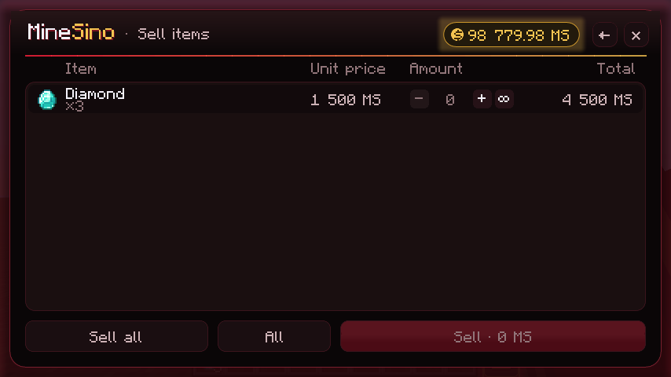
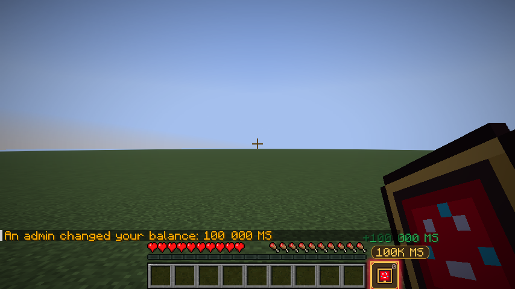
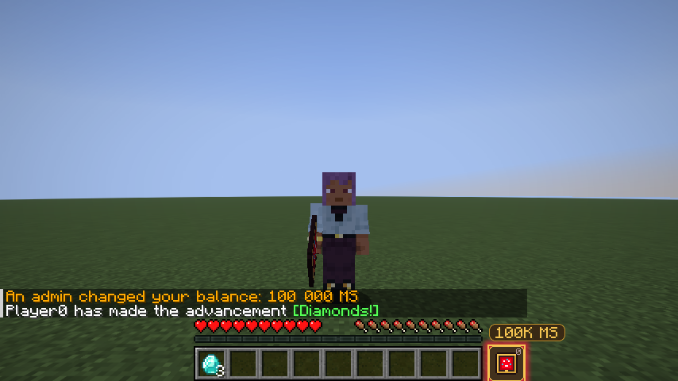

<div align="center">


# MineSino

**Казино и экономика прямо в хотбаре — Minecraft 26.3 · Fabric**


Планшет в отдельном **10-м слоте**, **12 игр казино**, продажа предметов и мобов, магазин с яйцами призыва.
Все деньги считает сервер — без дюпов и подмены пакетов.

[**⬇ Скачать последний релиз**](../../releases/latest)



</div>

---

## ✨ Возможности

| | |
|---|---|
| 📱 **Планшет в 10-м слоте** | Клавиша **0**, колесо мыши по кругу 1…9 → планшет. **ПКМ** открывает MineSino, над слотом виден баланс. Планшет нельзя выбросить, потерять или дюпнуть — это виртуальный слот, а не предмет. Другие игроки видят его у вас в руке. |
| 🎲 **12 игр** | Рулетка, слоты, блэкджек, плинко, краш, мины, кубик, монетка, апгрейд, колесо фортуны, хай-лоу, кено. Отдача 94–99 %. |
| 💰 **Экономика MS** | Точный расчёт до сотых, баланс сохраняется между сессиями, история всех операций и статистика. |
| 🧺 **Продажа** | Предметы из инвентаря с предпросмотром суммы. Мобы — **Shift + ПКМ** с выбранным планшетом. |
| 🛒 **Магазин** | Блоки, ресурсы, еда, редкие предметы и **яйца призыва**, количество 1 / 4 / 16 / 32 / 64. |
| 📐 **Честные цены** | 1250+ предметов, цены выведены из реальных рецептов: крафт с последующей продажей никогда не приносит прибыли. |
| 🛡️ **Безопасность** | Результат раунда генерирует сервер после списания ставки. Каждая операция проводится ровно один раз. Атомарное сохранение с резервными копиями. |

## 📸 Скриншоты

<table>
<tr>
<td width="50%"><p align="center"><b>Лобби казино</b></p></td>
<td width="50%"><p align="center"><b>Краш — вывод в любой момент</b></p></td>
</tr>
<tr>
<td><p align="center"><b>Европейская рулетка</b></p></td>
<td><p align="center"><b>Слоты на 5 линий</b></p></td>
</tr>
<tr>
<td><p align="center"><b>Мины 5×5</b></p></td>
<td><p align="center"><b>Магазин и яйца призыва</b></p></td>
</tr>
<tr>
<td><p align="center"><b>Продажа предметов</b></p></td>
<td><p align="center"><b>10-й слот и баланс в HUD</b></p></td>
</tr>
<tr>
<td colspan="2" align="center"><p align="center"><b>Планшет в руке — его видят другие игроки</b></p></td>
</tr>
</table>

## 📦 Установка

| Компонент | Версия |
|---|---|
| Minecraft Java Edition | **26.3** |
| Fabric Loader | **0.19.5** или новее |
| Fabric API | **0.162.0+26.3** |
| Java | **25** |

1. Скачайте `minesino-0.1.2.jar` из [релизов](../../releases/latest).
2. Положите его вместе с Fabric API в папку `mods`.
3. Мод нужен **и на сервере, и на каждом клиенте**. В одиночной игре и LAN всё работает на встроенном сервере хоста; для выделенного сервера подходит тот же jar.

## ⌨️ Управление

| Действие | Как |
|---|---|
| Выбрать планшет | клавиша **0** (переназначается в *Настройки → Управление → MineSino*) |
| Вернуться к слотам 1–9 | клавиши **1–9** или колесо мыши |
| Открыть MineSino | **ПКМ** с выбранным планшетом |
| Продать моба | **Shift + ПКМ** по мобу, затем подтвердить |

Пока выбран планшет, атака и ломание блоков отключены, Q и F ничего не делают.

## 🎲 Игры

| Игра | Правила | RTP |
|---|---|---|
| 🎡 Рулетка | европейская, 37 ячеек; прямая 35:1, цвет/чёт/половины 1:1, дюжины/колонки 2:1 | 97,30 % |
| 🍒 Слоты | 3×3, 5 линий, таблица выплат в конфиге | ≈94,5 % |
| 🃏 Блэкджек | 6 колод, дилер стоит на soft 17, блэкджек 3:2 | — |
| 🔻 Плинко | 8 / 12 / 16 рядов, три уровня риска | 98,9–99,1 % |
| 🚀 Краш | множитель растёт в реальном времени, «Забрать» в любой момент, есть автовывод | 97 % |
| 💣 Мины | поле 5×5, 1–24 мины, забрать после любого хода | 98 % |
| 🎲 Кубик | 1–5 граней из 6 | 98 % |
| 🪙 Монетка | орёл / решка, ×1,96 | 98 % |
| ⬆️ Апгрейд | деньги или предмет, шанс = 95 % / множитель | 95 % |
| 🎯 Колесо фортуны | 30 секторов от ×0 до ×5 | 96 % |
| 🂠 Хай-Лоу | старше / младше, серия множителей | 97 % за шаг |
| 🔢 Кено | 1–10 чисел из 40, тянется 10 | ≈95 % |

Закрыли планшет посреди блэкджека, мин, хай-лоу или полёта ракеты — сервер сам завершит раунд и пришлёт уведомление. Если сервер упал с незавершёнными раундами, ставки вернутся ровно один раз.

## 💰 Экономика и цены

- Ориентиры: земля **0.4**, булыжник **2**, доска **5**, железный слиток **100**, алмаз **1 500**, незеритовая броня **32 600–38 600**, яйцо дракона **1 000 000 MS**.
- Минимальная цена — 0.1 MS; ванильные предметы без своей цены продаются за 0.1 MS.
- Покупка = цена × 2 (настраивается). Предметы других модов запрещены, пока администратор их не разрешит.
- Питомцы, именованные мобы, детёныши, жители, боссы и игроки не продаются. Животные из разведения стоят 25 %.
- Голем стоит как его рецепт: железный = 4 блока железа + тыква (3 608 MS), снежный и медный — так же по рецепту. Эвокер, шалкер, поборник и другие стоят не меньше своего лута.
- Начального баланса нет: деньги зарабатываются продажей.

## 🔧 Команды

| Команда | Кто |
|---|---|
| `/balance` | все |
| `/balance <игрок>` | админ |
| `/balance set\|add\|remove <игрок> <сумма>` | админ (работает и для офлайн-игроков) |
| `/minesino info` | все |
| `/minesino stats [игрок]`, `/minesino history [игрок] [стр]` | свои — все, чужие — админ |
| `/minesino reload` | админ |

Админ — оператор с уровнем `permissions.adminLevel` (по умолчанию 2) или игрок из `permissions.adminPlayers`.

<details>
<summary><b>⚙️ Конфигурация</b></summary>

Файлы лежат в `config/minesino/` и создаются при первом запуске; комментарии `//` допускаются.

| Файл | Что внутри |
|---|---|
| `minesino.json` | валюта, лимиты ставок, игры и коэффициенты, продажа, магазин, яйца призыва, мобы, права, хранение |
| `minesino.example.json` | всегда актуальный пример со всеми параметрами |
| `prices.json` | базовые цены по категориям, переопределения, запреты |
| `mob_prices.json` | цены мобов, формулы големов, запреты |
| `config/minesino-client.json` | анимации, звук, HUD |

Неверное значение даёт предупреждение в логе и заменяется безопасным. `/minesino reload` не трогает балансы и активные раунды.
</details>

<details>
<summary><b>💾 Хранение данных</b></summary>

- `<мир>/minesino/economy.json` — балансы, история, статистика, применённые операции, незавершённые раунды. Запись атомарная (временный файл → fsync → перемещение), 5 ротируемых копий `.bak`. Повреждённый файл сохраняется как `.corrupt-<время>`, данные восстанавливаются из копии.
- Сохранение идёт вместе с миром, при выходе игрока и при остановке сервера — в фоновом потоке.
- `<мир>/minesino/journal/journal-ГГГГ-ММ-ДД.log` — журнал операций, действий админов и подозрительных запросов.
</details>

<details>
<summary><b>🧩 Как устроен 10-й слот</b></summary>

Ванильный инвентарь не расширяется: номера слотов зашиты в меню и сетевой протокол. Поэтому планшет — **виртуальный слот**: сервер хранит только флаг «слот 10 выбран», реального `ItemStack` нет. Отсюда:
- выбросить, положить в сундук, продать или дюпнуть планшет невозможно;
- он не теряется при смерти и перезаходе;
- поддельный `minesino:tablet` (например, из `/give`) сервер удаляет;
- действия «скрытым» предметом слотов 1–9 блокируются, пока выбран планшет.
</details>

<details>
<summary><b>🛠 Сборка и тесты</b></summary>

```bash
./gradlew build
```

Готовый мод: `build/libs/minesino-0.1.2.jar`.

```bash
./gradlew test
```

67 модульных тестов: экономика, хранение, цены, игры, мобы, магазин, защита от повторов, права.

```bash
./gradlew runClientGameTest
```

Сквозной тест в настоящем клиенте 26.3: мир, клавиша 0, ПКМ, все экраны, игры, продажа, магазин, моб, перезаход.

**Архитектура.** `dev.minesino` — общий серверный код (`economy`, `storage`, `config`, `pricing`, `mobs`, `selling`, `shop`, `casino`, `server`, `commands`, `tablet`, `network`). `dev.minesino.client` — HUD, ввод, миксины и собственная дизайн-система `gui`. Новая игра: реализовать `CasinoGame`, зарегистрировать в `MineSinoServer`, добавить страницу в `GamePages` и ключ в `casino.enabledGames`.
</details>

---

<div align="center">

Авторы: **matv1_x** и **Claude Code**

</div>
